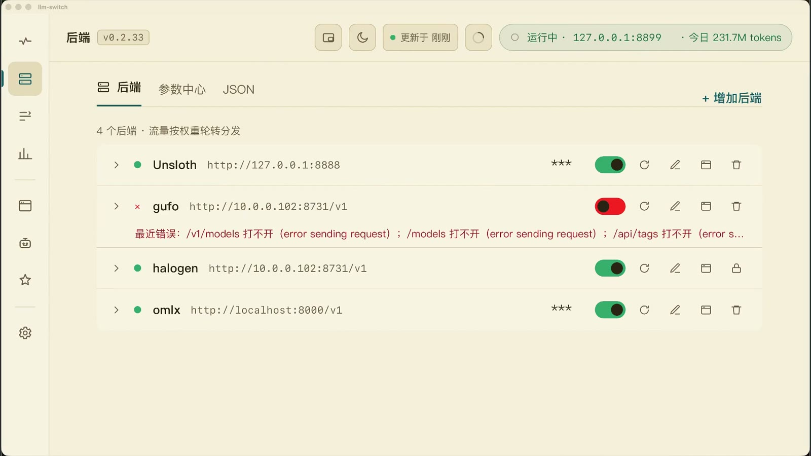
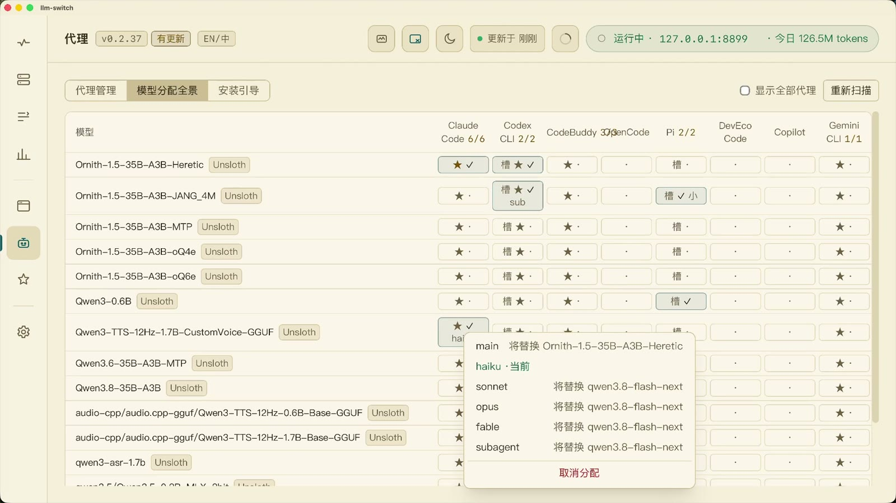
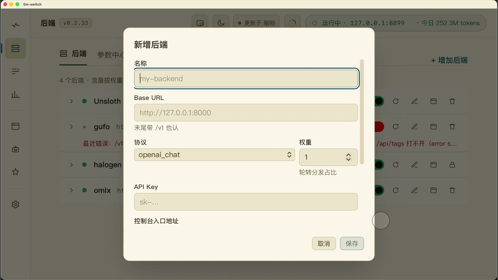

[中文](README.md) | **English**

# llm-switch

**Aggregate the compute scattered across your machines into one gateway — and turn a Bluetooth remote in your hand into physical buttons that drive your coding agents.**

> **A video explains it faster**: [Aggregating multi-machine compute, giving your agent wings](https://www.bilibili.com/video/BV1GVsA6bExE) (Bilibili · 7:33 · zh/en subtitles)

One machine no longer holds your inference needs: the lab box runs vLLM, another runs SGLang, your own Mac has llama.cpp, Ollama and oMLX, that AMD Ryzen AI Max+ 395 big-unified-memory machine in the corner was born to be an inference server, and you may still hold a few online APIs. Each machine has its own address, its own protocol, its own model names.

llm-switch **collects all of it into one local gateway**: no matter which machine it lives on, which engine it runs or which protocol it speaks, once it is attached it becomes the same endpoint. Your Claude Code, Codex, OpenCode, Gemini CLI, Pi, CodeBuddy, DevEco and Copilot only need to know this one endpoint — and after takeover, **each model slot of the same agent can sit on a different vendor**, which is exactly what Claude Code cannot do natively.

And it does more than forward: **drive the coding agents on your computer with a Xiaomi Bluetooth remote** — its buttons inject prompts and slash commands straight into the input box of the agent you are using; **assign models and skills to each agent in one click**; **fold image, speech and video generation into the same gateway**; **manage dedicated inference engines together with their start/stop, parameters, version updates and backups**. Work that used to mean hand-editing config files, hopping between machines and typing commands by hand, done in a few clicks in one window.

> **This project was written with llm-switch itself — Claude Code reached all the local LLMs through it.** The coding agent hangs off the local gateway, and the gateway forwards the models that did all the coding, debugging and documentation. If the gateway goes down the work stops — so the parts that must not fail were built for real.

---

## Core capabilities

| | Capability | In one line |
|---|---|---|
| ① | **Multi-machine compute + online APIs aggregated into one gateway** | Inference services on several machines plus online APIs, all attached to one gateway endpoint |
| ② | **Automatic protocol conversion** | Agents speak different dialects; the gateway converts between them, so any model can be called by anyone |
| ③ | **One agent using several vendors' models at once** | Claude Code natively has a single upstream endpoint, so every tier must come from one vendor; the slot system plus gateway routing by model name lets each slot hold a model from a different vendor |
| ④ | **A remote control for the coding agents on your computer** | Xiaomi Bluetooth remote buttons → prompts / slash commands injected into the agent you are using — a big relief from hand-typing, and fully customizable |
| ⑤ | **Image / speech / video generation through the same gateway** | Generation, TTS, transcription and video jobs routed by model name, passed through untouched, accounted in one place |
| ⑥ | **Assign models and skills to agents in one click** | One panorama table, click a cell to toggle; assigning takes over, clearing rolls back; one skill library distributed to everyone |
| ⑦ | **Dedicated inference engines as backends** | Engine start/stop, parameters, metrics, logs and version updates with backups in the same console |
| ⑧ | **Rate display for mainstream agents** | Install the throughput extension into eight coding agents with one click and watch live speed inside each agent's own UI |
| ⑨ | **Prompt quick-pick and one-click injection** | A global hotkey or the remote opens a floating panel; selecting inserts at the cursor — the remote's buttons use the same injection path |

---

## Features

### Many machines, one gateway

- Attach **vLLM, SGLang, llama.cpp, Ollama, oMLX, LM Studio** and any OpenAI-compatible service or online API.
- Adding a backend takes three things: a name, an address, an engine type.
- **Scan models**: point at the address, the available models are listed, tick the ones you want — no hand-typed model ids.
- **Probe**: a button per row tells you right now whether it is alive.
- Backends are added, edited and deleted in the UI; deletion is hard, and the confirmation tells you exactly what else gets removed.

### Every agent speaks its own dialect; the gateway translates

Claude Code speaks Anthropic, Codex speaks OpenAI, Gemini CLI speaks Gemini. llm-switch serves **Anthropic Messages, OpenAI Chat Completions, OpenAI Responses and Gemini generateContent** at the same time and converts between them — tool calls, streaming and error payloads are aligned field by field, so the client never notices a gateway in the middle.

If no enabled backend can serve the requested model, you get an explicit error instead of a guess.

### Image, speech and video generation through the same gateway

- The gateway serves `/v1/images/generations`, `/v1/images/edits`, `/v1/audio/speech`, `/v1/audio/transcriptions` and video-job endpoints: **pick the backend by model name and stream the bytes through untouched** — nothing lands on disk, nothing is parsed, nothing is transcoded.
- Models are classified by job type (chat / image / speech / transcription / video) and the classes are **mutually exclusive**: chat routing never selects an image model, and media models never enter the allocation grid.
- For video backends that work as create-job → poll → fetch, the gateway acts as a **job-affinity proxy**: the whole job stays pinned to one backend instead of changing machines halfway.
- **One accounting**: image counts, audio seconds, transcription minutes and video jobs land in the Usage page, showing `—` when unavailable; media requests also go through logs, metrics and the circuit breaker.

### Three states per backend: Off / Gateway / Direct

Each backend picks how it is consumed, via one segmented control at the end of the row:

- **Off**: excluded from all routing.
- **Gateway** (default): requests are forwarded by llm-switch, with stats, rate limits and failover in effect.
- **Direct**: taken-over agents connect straight to that backend's real address, bypassing the gateway — usage stats, rate line, in-flight monitoring, rate limiting and failover for that backend **honestly stop working and say so**, never pretend otherwise.
- API keys never enter any client config file; they come from the environment variable `LLM_SWITCH_<BACKEND_NAME>_KEY`, and when it is missing the page hands you the exact `export` line to copy.
- Switching back to Gateway rewrites the config automatically — reversible at any time.

### One agent using several vendors' models at once

**Claude Code cannot do this natively.** Its config holds a single `ANTHROPIC_BASE_URL`: every request — the default tier and the haiku / sonnet / opus / fable / subagent tiers — goes to that one endpoint. So:

- "opus from the official API, haiku from a cheap local model, subagents from yet another vendor" is impossible: every tier must come from one vendor;
- non-Anthropic models served by your local vLLM / Ollama don't speak the protocol and never get in;
- writing another vendor's model id into the config is useless — that one endpoint doesn't know it.

llm-switch's answer has three steps:

1. **Take over**: point the agent at the local gateway. **The file is backed up before writing and rolls back byte-for-byte** — your data is never moved.
2. **The gateway routes by model name**: the model id decides which backend gets the request, and a backend can be any machine, any engine, any vendor; the four protocol entrances convert between them, so non-Anthropic backends feed Claude Code just as well.
3. **Each slot takes its own model**: every tier slot is filled with a model id exposed by the gateway — inside one Claude Code instance, different tiers land on different vendors' backends.

The **model allocation panorama** collapses all of this into one table: one model per row, one agent per column, click a cell to claim a slot, click again to clear — **assigning takes over, clearing releases the takeover**; a full slot is explicitly refused, never silently dropped.

Slots per agent:

| Agent | Slots |
|---|---|
| Claude Code | default + haiku / sonnet / opus / fable / subagent (6 slots) |
| CodeBuddy | default + lite / reasoning (3 slots) |
| Pi | main / small (2 slots: new turns use main, light continuation uses small — cheaper, and the cache stays warm) |
| Codex CLI | main / subagent (2 slots) |
| Gemini CLI | 1 default tier |
| OpenCode · DevEco Code · Copilot | model list, unlimited |

- **Preset restore**: each agent's whole config is archived; restore everything or one agent, with a snapshot of the current files taken before overwriting.

### A remote control for the coding agents on your computer

Put a **Xiaomi Bluetooth Remote 2 / 2 Pro** next to your keyboard (pair it once) and the coding agents on your computer get a row of physical buttons:

- **All 12 buttons are assignable**: directions / OK / back / home / menu / TV / power / volume ±, as built-in actions, custom shortcuts or launching an app; long-press repeat and rapid-fire are per-button toggles.
- **A button is a prompt trigger**: one press injects your Nth prompt or an agent slash command **into the input box of the agent currently in the foreground** — inserted, not replaced, no auto-enter, focus returns to the terminal. Six sets of agent slash commands (`/status`, `/compact`, `/review` …) ship preset; whatever is in the prompt library is your own words.
- **Key schemes follow the foreground app**: several mappings are stored — one inside Codex, another inside Claude Code — and the scheme switches automatically with the app; if nothing matches, the default scheme takes over, never a button with a different meaning.
- **Hold to talk, the IME types it out**: voice key → the remote's microphone → a system loopback virtual microphone (BlackHole 2ch on macOS) → your usual input method / voice tool types as always. No built-in transcription, no upload, nothing written to disk.
- **Only three permissions**: Bluetooth, Input Monitoring, Accessibility. **No microphone permission**, no reading what you have typed, no account login — that privacy boundary is stated on the page.
- The status card lights up per channel: model / firmware / battery, with Bluetooth and button channels reported separately, each missing item named.

Ships on macOS first; on other platforms the page states "not supported on this platform" honestly, with Linux / Windows backends planned.

### Prompt quick-pick floating panel: global hotkey, select to insert

The remote's buttons sit on the same injection path, and the panel works without a remote:

- A **global hotkey** (default `Option/Alt+Shift+P`, customizable) opens a topmost panel with **fuzzy search** across every entry; Enter or click injects.
- One tab for general prompts, **one tab per agent**, each agent's slash commands filed separately; add / edit / delete right in the panel, stored in local SQLite.
- Injection is clipboard + simulated system paste: it lands at the cursor, **inserted rather than replacing, never auto-entering**, stable across terminals; the panel closes and focus returns to the terminal.
- The panel docks to a screen edge, collapses into a round button, and remembers its size and position.

### Configure skills for agents in one click

- **One skill library as the single source of truth**, symlinked or copied into each agent's directory after a scan — no manual copying.
- **Allocation panorama**: one table shows which agents got which skill; click a cell to toggle.
- **Check updates** only compares, never touches files; every uninstall or distribution takes a backup, so mistakes are recoverable.
- Skills can also be discovered and imported with one click.

### Ponytail plugin and rate extension, installed per agent

- **Ponytail** (the "lazy senior engineer" mode plugin, MIT) is installed, removed and update-checked by llm-switch per agent: pi, Claude Code, CodeBuddy, Codex, Copilot, Gemini CLI, OpenCode and DevEco each use a different official plugin mechanism — one button here instead of re-running eight CLIs on every upgrade.
- Its source lives in a local data directory and **only upstream tags are followed**; upstream update detection runs **GitHub Releases and npm in parallel**, showing "upstream latest / local checkout / installed per agent" as three honest layers — a failed check never lies with "you're up to date".
- **Rate extension**: the same throughput extension is installed into eight mainstream agents (**Pi · Claude Code · CodeBuddy · OpenCode · DevEco · Codex · Gemini CLI · Copilot**), each via **that agent's own official extension mechanism**, so throughput shows up in the agent's own UI.
  - **Install / uninstall with one click**, with a backup before overwriting or removing.
  - **One single rate calculation**: extensions read from the same gateway outlet as the monitor page and the floating panels — same source, same definition, everywhere.
  - **Layout only, no estimation**: when the gateway is not running it honestly says "unavailable" instead of inventing numbers; the menu-bar rate line can be toggled per agent.

### Dedicated inference engines, attached as backends

A dedicated inference engine (halogen, gufo, Unsloth Studio, oMLX…) is not "something outside the gateway". Once attached as a backend:

- **Start and stop from the console**, no SSH needed.
- **Parameters go down the engine's native channel**: model-level parameters are written into the engine itself when saved, and the receipt states honestly whether it was written, needs a restart, or this backend has no model-level channel. Nothing is force-fitted on a guess.
- **Status, metrics and logs** in the same panel.
- **Version updates and backups happen there too**: target versions are validated against a **whitelist**, a missing image is pulled before starting, a backup is taken before updating, and **any backup slot rolls back with one click** — no machine access at any point.

An **AMD Ryzen AI Max+ 395 (Strix Halo)** big-unified-memory machine attached as a backend behaves exactly like any other: probe, model scan, parameter delivery and rate observation are all isomorphic, and clients notice nothing.

### Visible: live monitor, logs, usage

- **Live monitor**: prefill / decode rate, time-to-first-token, throughput and upstream KV-cache telemetry per active stream. Only models with traffic in the last 60 seconds are listed — no noise.
- **Logs**: filter by level, backend, model and errors-only, follow live, copy a request id with one click, export with the current filter applied.
- **Usage**: today / 7 days / 30 days — request counts, token breakdown, cache hit rate, P50 / P95 latency buckets, traffic per backend, cost per model, plus media accounting (images / seconds / minutes / jobs), exported as a spreadsheet. Self-hosted backends are not billed; online APIs are priced at the unit prices you enter.
- **One single rate calculation**: monitor page, floating panel and the in-agent rate display all read the same outlet, so three places never disagree.

### Steady: routing, circuit breaker, affinity, cache

- **Multi-backend routing**: weighted round-robin, round-robin, least-load, failover, cache-aware.
- **Circuit breaker and retries**: consecutive-failure threshold, half-open recovery, error-rate tripping; with too few samples the error rate is ignored, so it does not trip on noise.
- **Session affinity**: one conversation sticks to one backend so the upstream cache stays warm.
- **Response cache**: hot memory tier + cold disk tier, size is yours to set, off by default; requests carrying tool calls are never cached.
- **Parameter centre**: request > model > global > backend, four levels of override; values beyond a backend's capability are clamped to its boundary.

### Desktop experience

- **Menu-bar resident**: today's requests / tokens / cost, pause or resume accepting work, quick backend switch, plus the per-agent rate line.
- **Multi-line floating panel**: same cadence and definition as the monitor page, one second per refresh; three more floats do their own jobs — system resources, rate line, prompt panel.
- **Two themes**: deep green (dark) and warm white (light), remembered locally, following the system on first run.
- **Command palette** `Cmd+K`: searches pages and actions; `Cmd+1…9` jumps to the nine pages.
- Closing the window does not quit — it lives in the menu bar. It can also run headless as a service.

---

## Screens

Nine pages, in `⌘1–9` order: **Live monitor · Backends · Logs · Usage ｜ Backend console · Remote · Agents · Skills ｜ Settings**.

| Page | What you do there |
|---|---|
| Live monitor | Who is running, how fast, time to first token, is the cache warm |
| Backends | Add backends, probe, scan models, three-state consumption (Off / Gateway / Direct), parameter centre, rate calibration |
| Logs | Filter, follow live, copy request ids, export |
| Usage | Requests, tokens, cost, hit rate, latency percentiles, media accounting, export |
| Backend console | Each engine's own UI embedded; halogen / gufo use native panels, including start-stop and version updates |
| Remote | Scan and connect the remote, key mapping, key schemes, voice outlet and permission check |
| Agents | Takeover status per agent, model allocation panorama (slots), rate extension and Ponytail plugin, preset restore |
| Skills | Skill library, allocation panorama, check updates, backup & restore, discover & import |
| Settings | Machine and engine status, protocol endpoints, accept toggle, routing policy, circuit breaker, cache, floating panel, client takeover |

**Backends** — every engine you attached: probe, weight round-robin, today's tokens.



**Agents · model allocation panorama** — one model per row, one agent per column; click a cell to put that model into that agent's slot.



**Adding a backend takes four fields** — name, address, protocol, weight; keys with an `sk-` prefix stay on your machine.



---

## Quick start

1. **Download** from [Releases](https://github.com/Lowkey119/llm-switch/releases) (macOS Apple Silicon / Windows / Linux).
2. **Install**: on macOS, drag into Applications and open it. An unsigned build may be blocked by Gatekeeper on first launch ("is damaged") — see [Won't open: "damaged, can't be opened"](#wont-open-damaged-cant-be-opened) below.
3. **Add a backend**: open Backends, fill name / address / engine type, click "Scan models" and tick what you want.
4. **Attach an agent**: open Agents and click "Take over", or simply click a cell in the allocation panorama — **assigning takes over**. A backup is written first and you can roll back any time.
5. **(Optional) Pair the remote**: open the Remote page, scan and connect your Xiaomi Bluetooth remote, and bind your commonly-used prompts to buttons.

Closing the window does not quit — it is in the menu bar. Background only: `llm-switch --headless`.

---

## Won't open: "damaged, can't be opened"

The macOS build is **ad-hoc signed and not notarized by Apple** (no fee, nothing uploaded — the cost is that Gatekeeper blocks the first launch).
Files downloaded by a browser get an "quarantine" flag, so you see:

> "llm-switch" is damaged and can't be opened. You should move it to the Trash.

**The file is not broken and the install did not fail.** The app itself is fine. Pick either fix.

### Option 1: allow it in System Settings (no terminal)

1. Drag the app into Applications first.
2. Open **System Settings → Privacy & Security**.
3. Scroll down to "llm-switch was blocked…" and click **Open Anyway**.
4. Click **Open** in the dialog. Double-clicking works from then on.

> No "Open Anyway" button? In Finder, **control-click (or right-click) the app → Open**, confirm once; the system remembers and the entry appears in Privacy & Security.

### Option 2: strip the quarantine flag (one command)

```bash
xattr -dr com.apple.quarantine /Applications/llm-switch.app
```

If the app lives elsewhere, use its real path. No restart needed.

> This only removes the quarantine flag macOS puts on downloaded files; it does not modify the app.
> To check whether the flag is set: `xattr -l /Applications/llm-switch.app`

### Why no notarization

Apple notarization requires a paid Developer ID account. This project is MIT licensed and free, so it ships ad-hoc signed with the two workarounds above.
If you prefer, re-sign it yourself:

```bash
codesign --force --deep -s - /Applications/llm-switch.app
```

### Other platforms

- **Windows**: at the SmartScreen prompt choose "More info" → "Run anyway".
- **Linux**: give the AppImage the executable bit first: `chmod +x llm-switch_*.AppImage`.

---

## FAQ

- **Can Claude Code really use several vendors' models at once?** Yes. After takeover every request goes to the local gateway alone; each tier slot gets a model id exposed by the gateway, and the gateway routes it to a different vendor's backend — see "One agent using several vendors' models at once" above.
- **Want to undo a takeover?** Use "Roll back" for that agent on the Agents page, or clear the cell in the panorama (clearing releases the takeover) — it restores the file byte-for-byte.
- **What does the remote need installed?** Buttons work out of the box; "hold to talk" needs a loopback virtual microphone (BlackHole 2ch on macOS, one `brew install blackhole-2ch`). No microphone permission is ever requested.
- **What happens if the gateway dies?** The in-agent rate display honestly reports "unavailable" instead of inventing numbers, and reconnects automatically.
- **Where are online API keys stored?** In your local config. Nothing is uploaded anywhere; in Direct mode they don't even enter the config file — environment variables only.
- **Can I skip the UI?** Yes — run it headless as a service; the interface is just another shell over the same core.

More questions in the issue tracker.

---

## Building

```bash
npm --prefix ui ci
npm --prefix ui run build
cd src-tauri && ../ui/node_modules/.bin/tauri build --features gui
```

Run the gate before committing (rustfmt / clippy including `--features gui` / cargo test / frontend build and lint / contrast and file-size budgets):

```bash
./scripts/gates.sh
```

Artifacts land in `target/release/bundle/` (`.dmg` on macOS, `.msi` / `.exe` on Windows, `.deb` / `.AppImage` on Linux).

---

## Credits

llm-switch stands on the shoulders of these projects, or integrates them:

| Project | Relationship |
|---|---|
| [cc-switch](https://github.com/farion1231/cc-switch) | Part of the protocol conversion layer references it (MIT); see [`NOTICE`](NOTICE) |
| [Unsloth](https://unsloth.ai) | Unsloth Studio attached as a backend and console |
| [Ponytail](https://github.com/DietrichGebert/ponytail) | "Lazy senior engineer" mode plugin (MIT), installed per agent by llm-switch |
| halogen · gufo | **closed-source** inference engines, attached as backends only (not distributed with this repository; integrating them does not affect this project's own MIT license) |

Thanks to the authors and maintainers of those projects.

Note: llm-switch itself is MIT licensed. It can **attach** various inference engines; halogen and gufo are closed source — whether you use them is your call, and this repository does not distribute any of their components.

---

## License

MIT. Part of the protocol conversion layer references [cc-switch](https://github.com/farion1231/cc-switch) (Copyright (c) 2025 Jason Young, MIT); see [`NOTICE`](NOTICE) for the upstream copyright notice and license.
