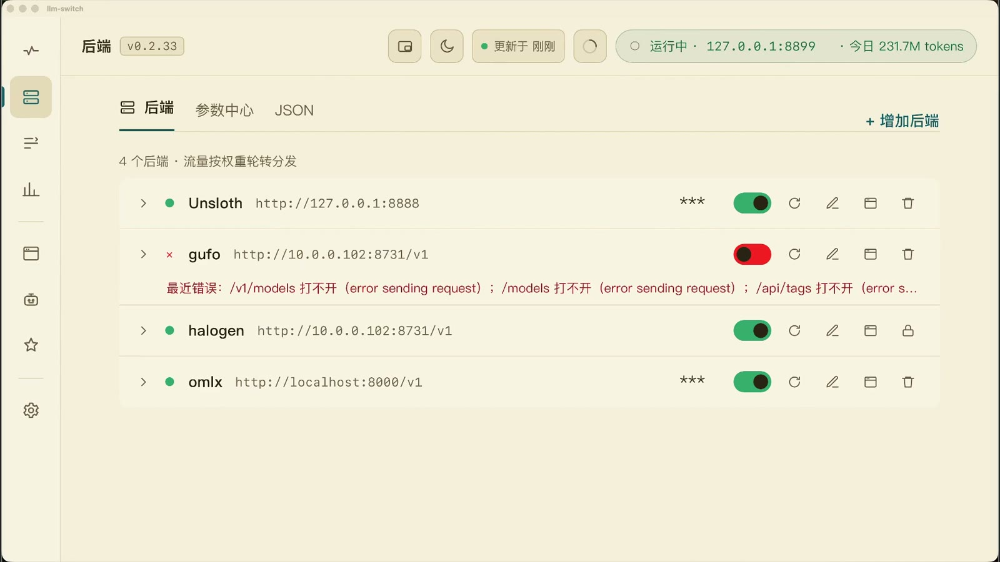
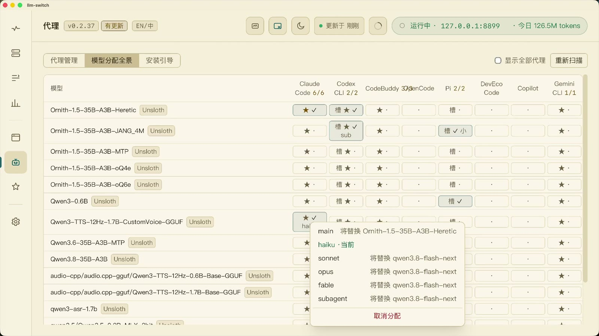

# llm-switch

**把散落在多台机器上的算力，聚合成一个网关，交给你的编码代理去用。**

> **先看视频更快理解**：[聚合多机器算力，给 Agent 插上翅膀](https://www.bilibili.com/video/BV1GVsA6bExE)（B 站 · 7 分 33 秒 · 中英字幕）

一台机器装不下你的推理需求了：实验室那台跑着 vLLM，另一台跑 SGLang，自己的 Mac 上还有 llama.cpp、Ollama、oMLX，角落里那台 AMD Ryzen AI Max+ 395 大统一内存机器本来就该当推理服务器使，手上可能还握着几家在线 API。每台机器有自己的地址、自己的协议、自己的模型名。

llm-switch 把这些**全部收进一个本地网关**：不管它在哪台机器上、跑什么引擎、说哪种协议，挂进来就是同一个端点。你的 Claude Code、Codex、OpenCode、Gemini CLI、Pi、CodeBuddy 只需要认这一个端点。

它还不只是转发：**给各代理一键分配模型**、**给各代理一键配置技能**、**把专用推理引擎连同它的启停、参数、版本更新与备份一起管起来**——这些原本要手工改配置、来回切机器的事，都在一个界面里点几下完成。

> **本项目就是用 llm-switch 自己写出来的。** 编码代理接在本地网关上，由它转发模型完成全部编码、调试与文档。网关一挂就没法干活——所以那些"不能掉链子"的部分，都是当真的做的。

---

## 核心能力

| | 能力 | 一句话 |
|---|---|---|
| ① | **多机算力 + 在线 API 聚合** | 多台机器上的推理服务，加上在线 API，全部挂进一个网关端点，统一使用 |
| ② | **消息协议自动转换** | 各家代理说的协议不一样，网关自动互转，同一个模型谁都能调 |
| ③ | **一键给各代理分配模型** | 一张全景表把网关里的模型分给各代理，点格子启停，随时逐字节回滚 |
| ④ | **一键给各代理配置技能** | 一份技能库当唯一真源，一键分发到各家代理目录，谁装了哪个一表看清 |
| ⑤ | **专用推理引擎挂接为后端** | 引擎的启停、参数、指标、日志，在同一个控制台里管 |
| ⑥ | **halogen 引擎的更新与备份** | 版本更新走白名单、更新前自动留备份、备份一键回退 |
| ⑦ | **把 AMD 395+ 机器当推理服务器** | 大统一内存机器挂成后端，用起来和其他后端完全一样 |
| ⑧ | **为主流代理加速率显示** | 八家编码代理一键装上速率扩展，在自家界面里直接看当前吞吐 |

---

## 功能介绍

### 把多台机器的算力聚成一个网关

- 支持接入 **vLLM、SGLang、llama.cpp、Ollama、oMLX、LM Studio** 等常见推理服务，也支持任意兼容 OpenAI 协议的服务与在线 API。
- 加后端只要三样：名字、地址、引擎类型。
- **扫描模型**：填好地址点一下，后端有哪些模型自动列出来，勾选着加，不用手敲模型 id。
- **探活**：每一行一个按钮，立刻知道它到底活没活。
- 后端可以在界面里增删改；删除是硬删除，二次确认里会如实告诉你连带清掉了什么。

### 各家代理说各家话，网关自动翻译

Claude Code 说 Anthropic 协议，Codex 说 OpenAI 协议，Gemini CLI 说 Gemini 协议。llm-switch 同时提供 **Anthropic Messages、OpenAI Chat Completions、OpenAI Responses、Gemini generateContent** 四种入口，并且互相转换——工具调用、流式输出、错误信息都逐字段对齐，客户端感觉不出中间有个网关。

请求里的模型如果没有任何启用的后端能服务，返回明确提示，不瞎猜。

### 一键给各代理分配模型

- **模型分配全景**：一张表看清每个模型分给了哪些代理，点格子直接启停。
- **一键接管**：把某个代理的连接指向本地网关，**写之前整份备份，随时逐字节回滚**，不搬用户数据。
- 给 Pi 额外提供**主 / 小两个模型槽**：新消息走主模型，轻量续跑走小模型，既省钱又保住缓存。
- **预设配置一键还原**：各家代理整套配置存档，一键全量或按代理还原，覆盖前先快照现行文件。

### 一键给各代理配置技能

- **一份技能库当唯一真源**，扫描后软链或复制到各家代理目录，不用一份份手抄。
- **分配全景**：一表看清每个技能进了哪些代理，点格子启停。
- **检查更新**只比对不动文件；每次卸载或分发都自动备份，误删能还原。
- 还能一键发现、导入技能。

### 专用推理引擎挂接为后端

引擎不是"网关之外的另一个东西"。专用推理引擎（halogen、gufo、Unsloth Studio、oMLX 等）以"后端"的形式挂进来之后：

- **控制台直控启停**，不用登机器敲命令。
- **参数按引擎原生通道下发**：模型层的参数保存后会顺手写进引擎本体，回执如实说明"已写入 / 需要重启 / 该后端没有模型级通道"，绝不猜着硬塞。
- **状态、指标、中文日志**在同一个面板里看。

### halogen 引擎的更新与备份

halogen（以及 gufo）面板里直接做版本更新与恢复：目标版本走**白名单**校验，缺镜像先拉再起，更新前自动留备份，**备份槽一键回退**。整个过程不需要你登机器操作。

### 把 AMD 395+ 机器当推理服务器

AMD Ryzen AI Max+ 395（Strix Halo）这类大统一内存机器很适合当本地推理服务器。llm-switch 让它用起来和其他后端没有任何区别：探活、模型扫描、参数下发、速率观测全都同构，客户端完全无感。

### 为主流代理加速率显示

写代码时最想知道的就是「现在跑多快」。llm-switch 为八家主流代理（**Pi · Claude Code · CodeBuddy · OpenCode · DevEco · Codex · Gemini CLI · Copilot**）各按**自己的官方扩展机制**装上同一个速率扩展，在代理自己的界面里就能看到当前吞吐：

- **一键安装 / 卸载**，在代理详情页点一下就行；覆盖或卸载前自动备份。
- **速率只有一份计算**：扩展一律从网关同一个出口取数（引擎原生速率优先，取不到时退回按后端与模型纠偏后的字节口径），与监控页、浮窗完全同源同口径。
- **只排版不估算**：网关没跑时如实说「取不到」，绝不编数字。
- 菜单栏里的速率状态线还能**逐家单独开关**（哪几家开着直接打勾）。

### 看得见：实时监控、日志、用量

- **实时监控**：每条活跃流的 prefill / decode 速率、首字延迟、吞吐、上游 KV 缓存遥测。只列最近 60 秒真有流量的模型，不堆噪音。
- **日志**：按级别、后端、模型、仅错误过滤，实时跟随，请求 id 一键复制，可按当前过滤条件导出。
- **用量**：今日 / 近 7 天 / 近 30 天，请求数、token 明细、缓存命中率、P50 / P95 分档、按后端看流量、按模型看成本，一键导出表格。本地自托管不计费，在线 API 按你填的单价计价。
- **速率只有一份计算**：监控页、浮动面板、各家代理里的速率显示，全部取自同一个出口，口径一致，不会出现三处数字打架。

### 稳得住：择路、熔断、亲和、缓存

- **多后端择路**：加权轮转、轮询、最少负载、故障转移、缓存感知。
- **熔断与重试**：连续失败阈值、半开恢复、错误率开断；样本太少时不看错误率，避免误开断。
- **会话亲和**：同一段对话钉在同一后端，让上游缓存保持温热。
- **响应缓存**：内存热层 + 磁盘冷层，容量自己定，默认关闭；带工具调用的请求永不缓存。
- **参数中心**：请求 > 模型 > 全局 > 后端 四级覆盖，超出后端能力的值自动钳到边界。

### 桌面体验

- **菜单栏常驻**：今日请求数 / tokens / 成本、暂停或恢复接单、快速切后端，速率状态线还能逐家开关。
- **多行浮动面板**：和监控页同频同口径，一秒刷新，不用切窗口。
- **两套主题**：深绿（暗）与暖白（亮），选择记在本地，首次进入跟随系统。
- **命令面板** `Cmd+K`：搜页面也搜动作；`Cmd+1…8` 直达八个页面。
- 关掉窗口不代表退出，它在菜单栏；也可以完全无界面当服务跑。

---

## 界面一览

八个页面：**实时监控 · 后端 · 日志 · 用量 · 后端控制台 · 代理 · Skills · 设置**。

| 页面 | 你会在这里做什么 |
|---|---|
| 实时监控 | 看谁在跑、跑多快、首字多久、缓存热不热 |
| 后端 | 加后端、探活、扫描模型、参数中心、速率标定、删除后端 |
| 日志 | 过滤、实时跟随、复制请求 id、导出 |
| 用量 | 请求数、token、成本、命中率、分位延迟、导出表格 |
| 后端控制台 | 各引擎自带界面内嵌进来；halogen / gufo 走原生面板，含启停与版本更新 |
| 代理 | 各代理接管状态、模型分配全景、速率扩展安装、预设还原 |
| Skills | 技能库、分配全景、检查更新、备份还原、发现导入 |
| 设置 | 机器与引擎状态、协议入口、接单开关、路由策略、熔断、缓存、浮窗、客户端接管 |

**后端页**——挂进来的每一个引擎：探活、权重轮转、今日 token。



**代理页 · 模型分配全景**——一行一个模型，一列一个代理，点格子就把模型分到那个代理的槽位上。



**加一个后端只要四行**——名字、地址、协议、权重；带 `sk-` 前缀的密钥只存本机。


---

## 快速上手

1. **下载**：到 [Releases](https://github.com/Lowkey119/llm-switch/releases) 下载 macOS 安装包（Apple Silicon）。
2. **安装**：拖进「应用程序」并打开。未签名的包首次打开可能被 Gatekeeper 拦（提示「已损坏」），见下文 [打不开？提示「已损坏，无法打开」](#打不开提示已损坏无法打开)。
3. **加后端**：进「后端」页，填名字、地址、引擎类型，点「扫描模型」勾选要用的模型。
4. **接代理**：进「代理」页，点对应代理的「接管」。写之前会自动备份，随时可以回滚。

窗口关掉不代表退出——它在菜单栏。只想后台跑：`llm-switch --headless`。

---

## 打不开？提示「已损坏，无法打开」

macOS 的包是 **ad-hoc 签名、没有做 Apple 公证**（不收费、不上传任何信息，代价就是首次打开会被 Gatekeeper 拦）。
浏览器下载的文件会被打上「隔离」标记，于是弹出：

> “llm-switch” 已损坏，无法打开。你应该将它移到废纸篓。

**这不是文件坏了，也不是装失败**，应用本身没问题。两种解法任选一种。

### 方法一：在系统设置里放行（不碰终端）

1. 先把 app 拖进「应用程序」，完成安装。
2. 打开 **系统设置 → 隐私与安全性**。
3. 往下滚，找到「已阻止使用 llm-switch…」这一条，点右边的 **「仍要打开」**。
4. 弹窗里再点一次 **打开**。之后双击就能正常启动。

> 没看到「仍要打开」？先在访达里对 app **按住 control 点击（或右键）→ 打开**，
> 确认一次后系统会记住，这条记录也会出现在隐私与安全性里。

### 方法二：命令行去掉隔离标记（一条命令）

```bash
xattr -dr com.apple.quarantine /Applications/llm-switch.app
```

app 不在「应用程序」里就把路径换成它的实际位置。执行完直接双击启动，不用重启。

> 这条命令只删掉 macOS 给下载文件打的「隔离」标记，不改动 app 内容。
> 想先确认有没有被标记：`xattr -l /Applications/llm-switch.app`

### 为什么不做公证

Apple 公证要付费的 Developer ID 账号。本项目 MIT 开源、不收费，所以走 ad-hoc 签名 + 上面两种放行方式。
介意的话也可以自己重签一次：

```bash
codesign --force --deep -s - /Applications/llm-switch.app
```

### 其它平台

- **Windows**：SmartScreen 提示时点「更多信息」→「仍要运行」。
- **Linux**：AppImage 先给可执行位 `chmod +x llm-switch_*.AppImage`。

---

## 常见问题

- **接管之后想换回去？** 代理页对应代理的「回滚」，逐字节还原成接管前的样子。
- **网关挂了会怎样？** 各代理的速率显示会如实说"取不到"，不会编数字；恢复后自动接上。
- **在线 API 的 key 存在哪？** 存在本机配置里，不上传任何地方。
- **能不能不用界面？** 可以，无界面模式当服务跑，界面只是它的另一个壳。

更多常见问题见仓库 Issue 区。

---

## 构建

```bash
npm --prefix ui ci
npm --prefix ui run build
cd src-tauri && ../ui/node_modules/.bin/tauri build
```

提交前跑一遍门禁（rustfmt / clippy 含 `--features gui` / cargo test / 前端构建与 lint / 对比度与体积预算）：

```bash
./scripts/gates.sh
```

产物在 `src-tauri/target/release/bundle/`（macOS 为 `.dmg`，Windows 为 `.msi` / `.exe`，Linux 为 `.deb` / `.AppImage`）。

---

## 致谢

llm-switch 站在这些项目的肩膀上，或把它们接了进来：

| 项目 | 关系 |
|---|---|
| [cc-switch](https://github.com/farion1231/cc-switch) | 协议转换层部分代码移植自它（MIT），上游署名见 [`NOTICE`](NOTICE) |
| [Unsloth](https://unsloth.ai) | Unsloth Studio 作为后端与控制台接入 |
| halogen · gufo | **闭源**推理引擎，仅作为后端接入（本仓库不含其源码，集成不影响本项目自身的 MIT 许可） |

感谢这些项目的作者与维护者。

说明：llm-switch 自身以 MIT 开源。它能**接入**各类推理引擎，其中 halogen、gufo 为闭源引擎——是否使用由你自行决定，本仓库不分发它们的任何组件。

---

## 许可

MIT。协议转换层部分代码移植自 [cc-switch](https://github.com/farion1231/cc-switch)（Copyright (c) 2025 Jason Young，MIT），上游版权声明与许可见 [`NOTICE`](NOTICE)。
