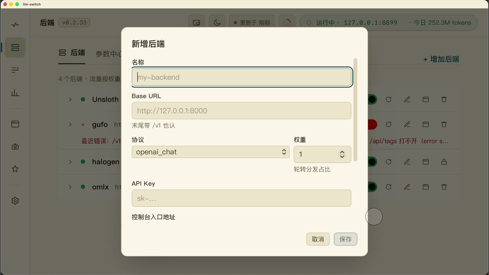

[**中文**](README.md) | [English](README.en.md)

# llm-switch

**把散落在多台机器上的算力聚成一个网关；把手里的蓝牙遥控器变成操控各编码代理的实体按键。**

> **先看视频更快理解**：[聚合多机器算力，给 Agent 插上翅膀](https://www.bilibili.com/video/BV1GVsA6bExE)（B 站 · 7 分 33 秒 · 中英字幕）

一台机器装不下你的推理需求了：实验室那台跑着 vLLM，另一台跑 SGLang，自己的 Mac 上还有 llama.cpp、Ollama、oMLX，角落里那台 AMD Ryzen AI Max+ 395 大统一内存机器本来就该当推理服务器使，手上可能还握着几家在线 API。每台机器有自己的地址、自己的协议、自己的模型名。

llm-switch 把这些**全部收进一个本地网关**：不管它在哪台机器上、跑什么引擎、说哪种协议，挂进来就是同一个端点。你的 Claude Code、Codex、OpenCode、Gemini CLI、Pi、CodeBuddy、DevEco、Copilot 只需要认这一个端点——接管之后，**同一个代理的每个模型槽还能各占一家厂商**，这正是 Claude Code 原生做不到的事。

它还不只是转发：**用一块小米蓝牙遥控器操控电脑里的各编码代理**——按键把提示词、斜杠命令直接送进正在用的那家代理的输入框；**给各代理一键分配模型与技能**；**把图像、语音、视频生成也收进同一个网关**；**把专用推理引擎连同它的启停、参数、版本更新与备份一起管起来**。这些原本要手工改配置、来回切机器、手打命令的事，都在一个界面里点几下完成。

> **本项目就是用 llm-switch 自己写出来的——Claude Code 经它连上各家本地 LLM。** 编码代理接在本地网关上，由它转发模型完成全部编码、调试与文档。网关一挂就没法干活——所以那些"不能掉链子"的部分，都是当真的做的。

---

## 核心能力

|     | 能力                        | 一句话                                                            |
| --- | ------------------------- | -------------------------------------------------------------- |
| ①   | **多机算力 + 在线 API 聚合成一个网关** | 多台机器上的推理服务，加上在线 API，全部挂进一个网关端点，统一使用                            |
| ②   | **消息协议自动转换**              | 各家代理说的协议不一样，网关自动互转，同一个模型谁都能调                                   |
| ③   | **一个代理同时用多家厂商的模型**        | Claude Code 原生只有一个上游端点，所有档位只能出自同一家；槽位制 + 网关按模型名择路，让每个槽可以各占一家模型 |
| ④   | **遥控器操控电脑里的各编码代理**        | 小米蓝牙遥控器的按键 → 提示词 / 斜杠命令注入正在用的那家代理的输入框，大大缓解手工打字的烦恼，这些完全可以自定义    |
| ⑤   | **图像 / 语音 / 视频生成也走网关**    | 生图、语音合成、转写、视频任务按模型名选后端、原样透传、统一记账                               |
| ⑥   | **一键给各代理分配模型与技能**         | 一张全景表点格子启停，分配即接管、清空即回滚；一份技能库真源分发到各家                            |
| ⑦   | **专用推理引擎挂接为后端**           | 引擎的启停、参数、指标、日志与版本更新备份，在同一个控制台里管                                |
| ⑧   | **为主流代理加速率显示**            | 八家编码代理一键装上速率扩展，在自家界面里直接看当前吞吐                                   |
| ⑨   | **提示词速取与一键注入**            | 全局快捷键/遥控器唤起浮窗，选中即注入光标处；遥控器按键走同一条注入链                            |

---

## 功能介绍

### 把多台机器的算力聚成一个网关

- 支持接入 **vLLM、SGLang、llama.cpp、Ollama、oMLX、LM Studio** 等常见推理服务，也支持任意兼容 OpenAI 协议的服务与在线 API。
- 加后端只要三样：名字、地址、引擎类型。
- **扫描模型**：填好地址点一下，后端有哪些模型自动列出来，勾选着加，不用手敲模型 id。
- **探活**：每一行一个按钮，立刻知道它到底活没活。
- 后端可以在界面里增删改；删除是硬删除，二次确认里会如实告诉你连带清掉了什么。

### 各家代理说各家话，网关自动翻译

Claude Code 说 Anthropic 协议，Codex 说 OpenAI 协议，Gemini CLI 说 Gemini 协议。llm-switch 同时提供 **Anthropic Messages、OpenAI Chat Completions、OpenAI Responses、Gemini generateContent** 四种入口，并且互相转换——工具调用、流式输出、错误信息都逐字段对齐，客户端感觉不出中间有个网关。

请求里的模型如果没有任何启用的后端能服务，返回明确提示，不瞎猜。

### 图像、语音、视频生成也走同一个网关

- 网关提供 `/v1/images/generations`、`/v1/images/edits`、`/v1/audio/speech`、`/v1/audio/transcriptions` 与视频任务端点：**按模型名选后端，二进制流式原样转发**——不落地、不解析、不转码。
- 模型按工种归类（聊天 / 生图 / 语音 / 转写 / 视频），**互斥焊死**：聊天择路永远不会选中一个生图模型，媒体模型也永远不进分配格子。
- 视频这种「建任务 → 轮询 → 取件」的后端，网关做**任务亲和代理**：整个任务钉在同一个后端上，不会轮询到一半换了机器。
- **统一记账**：图像张数、音频秒数、转写分钟数、视频任务数进用量页，取不到的如实显示 `—`；媒体请求同样进日志、指标与熔断。

### 直连三态：停用 / 网关 / 直连

每个后端可选取用方式，行尾一枚三态控件：

- **停用**：不参与任何路由。
- **网关**（默认）：请求由 llm-switch 转发，统计、限速、故障切换全生效。
- **直连**：已接管的代理直连该后端的真实地址，流量不经网关——该后端的用量统计、速率线、在飞监控、限速与故障切换**如实失效并明说**，不装作还在。
- API Key 不写进任何客户端配置文件，改由环境变量 `LLM_SWITCH_<后端名>_KEY` 提供；缺变量时页面直接给出那行 `export` 让你复制。
- 切回网关会把配置自动写回，随时可逆。

### 一个代理同时用多家厂商的模型

**Claude Code 原生做不到这件事。** 它的配置里只有一个 `ANTHROPIC_BASE_URL`：默认档与 haiku / sonnet / opus / fable / subagent 各档位的请求，全都发往这一个端点。于是：

- 想「opus 走官方、haiku 走便宜的本地模型、子代理走另一家」——做不到，所有档位只能出自同一家；
- 想用本地 vLLM / Ollama 里的非 Anthropic 模型——协议对不上，原生根本接不进来；
- 往配置里写别家的模型名也没用，那个唯一端点根本不认识它。

llm-switch 的解法分三步：

1. **接管**：把代理的连接指向本地网关，**写之前整份备份，随时逐字节回滚**，不搬用户数据。
2. **网关按模型名择路**：模型名决定去哪个后端，后端可以是任何机器、任何引擎、任何厂商；四种协议入口互转，非 Anthropic 的后端照样喂得饱 Claude Code。
3. **槽位各填各的**：每个档位槽各自填一个网关暴露的模型名——同一个 Claude Code 实例里，不同档位就落在不同厂商的后端上。

**模型分配全景**把这套分配收成一张表：一行一个模型、一列一个代理，点格子占槽、再点清空，**分配即接管、清空即取消接管**；满槽明确拒绝，绝不静默丢弃。

各家代理的槽位：

| 代理 | 槽位 |
|---|---|
| Claude Code | 默认档 + haiku / sonnet / opus / fable / subagent（6 槽） |
| CodeBuddy | 默认档 + lite / reasoning（3 槽） |
| Pi | 主模型 / 小模型（2 槽：新消息走主模型，轻量续跑走小模型，既省钱又保住缓存） |
| Codex CLI | 主模型 / 子代理模型（2 槽） |
| Gemini CLI | 1 个默认档 |
| OpenCode · DevEco Code · Copilot | 模型清单制，不限个数 |

- **预设配置一键还原**：各家代理整套配置存档，一键全量或按代理还原，覆盖前先快照现行文件。

### 遥控器：操控电脑里的各编码代理

手里多一块小米蓝牙遥控器（**小米蓝牙遥控器 2 / 2 Pro**，与本机配对一次），电脑里的编码代理就多了一排实体按键：

- **12 颗按键全部可指派**：方向 / 确定 / 返回 / 主页 / 菜单 / TV / 电源 / 音量 ±，动作可以是内置动作、自定义快捷键或启动应用；长按连发与快速连按逐键开关。
- **按键 = 提示词触发器**：按一下，就把第 N 条常用提示词或代理斜杠命令**注入正在前台使用的那家代理的输入框**——插入而非替换、不自动回车、焦点回到终端。六套代理斜杠命令（`/status`、`/compact`、`/review` …）开箱预置，提示词库里存的都是你自己的话。
- **键位方案跟随前台 App**：多套映射存着，进 Codex 是一套、进 Claude Code 是另一套，切到哪个 App 自动用哪套；匹配不到就回退默认方案，绝不静默换成含义不同的按键。
- **按住说话，输入法直接上屏**：语音键 → 遥控器麦克风采集 → 写进系统的回环虚拟麦克风（macOS 用 BlackHole 2ch）→ 你惯用的输入法 / 语音工具照常出字。不内置转写、不上传、不落盘。
- **权限只要三项**：蓝牙、输入监控、辅助功能。**不要麦克风权限**、不读你已输入的文字、不要账号登录——这条隐私边界写在页面明处。
- 状态卡分通道亮灯：型号 / 固件 / 电量，蓝牙与按键两条通道各自报状态，缺哪项说哪项。

首发 macOS；非 macOS 平台该页如实显示「平台不支持」，Linux / Windows 后端在计划中。

### 提示词速取浮动面板：全局快捷键，选中即注入

遥控器按键背后是同一条注入链，不用遥控器也能用：

- **全局快捷键**（默认 `Option/Alt+Shift+P`，可自定义）唤起置顶浮窗，**模糊搜索**跨全部条目，回车或点击即注入。
- 通用提示词一个 tab，**每家代理各一个 tab**，各家的斜杠命令分门别类；面板底部直接增删改，数据存本机 SQLite。
- 注入 = 剪贴板 + 模拟系统粘贴，落在光标处、**插入而非替换、不自动回车**，跨终端稳定；选完收窗，焦点回到终端。
- 浮窗可拖拽停靠屏幕边、可收缩成一个圆钮，尺寸位置记住。

### 一键给各代理配置技能

- **一份技能库当唯一真源**，扫描后软链或复制到各家代理目录，不用一份份手抄。
- **分配全景**：一表看清每个技能进了哪些代理，点格子启停。
- **检查更新**只比对不动文件；每次卸载或分发都自动备份，误删能还原。
- 还能一键发现、导入技能。

### Ponytail 插件与速率扩展，逐端一键装

- **Ponytail**（「懒惰资深工程师」模式插件，MIT）的装、卸、查更新由 llm-switch 逐端代劳：pi、Claude Code、CodeBuddy、Codex、Copilot、Gemini CLI、OpenCode、DevEco 八家的官方插件机制各不相同，这里统一一键，装完不用逐家重跑升级。
- 源码托管在本机数据目录、**只认上游 tag**；上游更新检测 **GitHub Releases 与 npm 双源并行**，「上游最新 / 本地检出 / 各端已装」三层版本如实分列，检测失败绝不谎报「已是最新」。
- **速率扩展**：八家主流代理（**Pi · Claude Code · CodeBuddy · OpenCode · DevEco · Codex · Gemini CLI · Copilot**）各按**自己的官方扩展机制**装上同一个速率扩展，在代理自己的界面里就能看到当前吞吐。
  - **一键安装 / 卸载**，覆盖或卸载前自动备份。
  - **速率只有一份计算**：扩展一律从网关同一个出口取数，与监控页、浮窗完全同源同口径。
  - **只排版不估算**：网关没跑时如实说「取不到」，绝不编数字；菜单栏里的速率状态线还能逐家单独开关。

### 专用推理引擎挂接为后端

引擎不是"网关之外的另一个东西"。专用推理引擎（halogen、gufo、Unsloth Studio、oMLX 等）以"后端"的形式挂进来之后：

- **控制台直控启停**，不用登机器敲命令。
- **参数按引擎原生通道下发**：模型层的参数保存后会顺手写进引擎本体，回执如实说明"已写入 / 需要重启 / 该后端没有模型级通道"，绝不猜着硬塞。
- **状态、指标、中文日志**在同一个面板里看。
- **版本更新与备份**也在面板里做：目标版本走**白名单**校验，缺镜像先拉再起，更新前自动留备份，**备份槽一键回退**，全程不用登机器。

**AMD Ryzen AI Max+ 395（Strix Halo）** 这类大统一内存机器挂成后端后，用起来和其他后端没有任何区别：探活、模型扫描、参数下发、速率观测全都同构，客户端完全无感。

### 看得见：实时监控、日志、用量

- **实时监控**：每条活跃流的 prefill / decode 速率、首字延迟、吞吐、上游 KV 缓存遥测。只列最近 60 秒真有流量的模型，不堆噪音。
- **日志**：按级别、后端、模型、仅错误过滤，实时跟随，请求 id 一键复制，可按当前过滤条件导出。
- **用量**：今日 / 近 7 天 / 近 30 天，请求数、token 明细、缓存命中率、P50 / P95 分档、按后端看流量、按模型看成本，外加媒体计量（张 / 秒 / 分钟 / 任务数），一键导出表格。本地自托管不计费，在线 API 按你填的单价计价。
- **速率只有一份计算**：监控页、浮动面板、各家代理里的速率显示，全部取自同一个出口，口径一致，不会出现三处数字打架。

### 稳得住：择路、熔断、亲和、缓存

- **多后端择路**：加权轮转、轮询、最少负载、故障转移、缓存感知。
- **熔断与重试**：连续失败阈值、半开恢复、错误率开断；样本太少时不看错误率，避免误开断。
- **会话亲和**：同一段对话钉在同一后端，让上游缓存保持温热。
- **响应缓存**：内存热层 + 磁盘冷层，容量自己定，默认关闭；带工具调用的请求永不缓存。
- **参数中心**：请求 > 模型 > 全局 > 后端 四级覆盖，超出后端能力的值自动钳到边界。

### 桌面体验

- **菜单栏常驻**：今日请求数 / tokens / 成本、暂停或恢复接单、快速切后端，速率状态线还能逐家开关。
- **多行浮动面板**：和监控页同频同口径，一秒刷新，不用切窗口；另有资源小窗、速率线、提示词面板三块浮窗各司其职。
- **两套主题**：深绿（暗）与暖白（亮），选择记在本地，首次进入跟随系统。
- **命令面板** `Cmd+K`：搜页面也搜动作；`Cmd+1…9` 直达九个页面。
- 关掉窗口不代表退出，它在菜单栏；也可以完全无界面当服务跑。

---

## 界面一览

九个页面，按 `⌘1–9` 的顺序：**实时监控 · 后端 · 日志 · 用量 ｜ 后端控制台 · 遥控器 · 代理 · Skills ｜ 设置**。

| 页面 | 你会在这里做什么 |
|---|---|
| 实时监控 | 看谁在跑、跑多快、首字多久、缓存热不热 |
| 后端 | 加后端、探活、扫描模型、三态取用（停用 / 网关 / 直连）、参数中心、速率标定 |
| 日志 | 过滤、实时跟随、复制请求 id、导出 |
| 用量 | 请求数、token、成本、命中率、分位延迟、媒体计量、导出表格 |
| 后端控制台 | 各引擎自带界面内嵌进来；halogen / gufo 走原生面板，含启停与版本更新 |
| 遥控器 | 扫描连接遥控器、按键映射、键位方案、语音出口与权限体检 |
| 代理 | 各代理接管状态、模型分配全景（占槽）、速率扩展与 Ponytail 插件、预设还原 |
| Skills | 技能库、分配全景、检查更新、备份还原、发现导入 |
| 设置 | 机器与引擎状态、协议入口、接单开关、路由策略、熔断、缓存、浮窗、客户端接管 |

**后端页**——挂进来的每一个引擎：探活、权重轮转、今日 token。


**代理页 · 模型分配全景**——一行一个模型，一列一个代理，点格子就把模型占进那个代理的槽位。


**加一个后端只要四行**——名字、地址、协议、权重；带 `sk-` 前缀的密钥只存本机。



---

## 快速上手

1. **下载**：到 [Releases](https://github.com/Lowkey119/llm-switch/releases) 下载安装包（macOS Apple Silicon / Windows / Linux）。
2. **安装**：macOS 拖进「应用程序」并打开。未签名的包首次打开可能被 Gatekeeper 拦（提示「已损坏」），见下文 [打不开？提示「已损坏，无法打开」](#打不开提示已损坏无法打开)。
3. **加后端**：进「后端」页，填名字、地址、引擎类型，点「扫描模型」勾选要用的模型。
4. **接代理**：进「代理」页点「接管」，或直接在模型分配全景里点格子——**分配即接管**。写之前会自动备份，随时可以回滚。
5. **（可选）接遥控器**：进「遥控器」页扫描连接你的小米蓝牙遥控器，把常用提示词绑上按键。

窗口关掉不代表退出——它在菜单栏。只想后台跑：`llm-switch --headless`。

---

## 打不开？提示「已损坏，无法打开」

macOS 的包是 **ad-hoc 签名、没有做 Apple 公证**（不收费、不上传任何信息，代价就是首次打开会被 Gatekeeper 拦）。
浏览器下载的文件会被打上「隔离」标记，于是弹出：

> “llm-switch” 已损坏，无法打开。你应该将它移到废纸篓。

**这不是文件坏了，也不是装失败**，应用本身没问题。两种解法任选一种。

### 方法一：在系统设置里放行（不碰终端）

1. 先把 app 拖进「应用程序」，完成安装。
2. 打开 **系统设置 → 隐私与安全性**。
3. 往下滚，找到「已阻止使用 llm-switch…」这一条，点右边的 **「仍要打开」**。
4. 弹窗里再点一次 **打开**。之后双击就能正常启动。

> 没看到「仍要打开」？先在访达里对 app **按住 control 点击（或右键）→ 打开**，
> 确认一次后系统会记住，这条记录也会出现在隐私与安全性里。

### 方法二：命令行去掉隔离标记（一条命令）

```bash
xattr -dr com.apple.quarantine /Applications/llm-switch.app
```

app 不在「应用程序」里就把路径换成它的实际位置。执行完直接双击启动，不用重启。

> 这条命令只删掉 macOS 给下载文件打的「隔离」标记，不改动 app 内容。
> 想先确认有没有被标记：`xattr -l /Applications/llm-switch.app`

### 为什么不做公证

Apple 公证要付费的 Developer ID 账号。本项目 MIT 开源、不收费，所以走 ad-hoc 签名 + 上面两种放行方式。
介意的话也可以自己重签一次：

```bash
codesign --force --deep -s - /Applications/llm-switch.app
```

### 其它平台

- **Windows**：SmartScreen 提示时点「更多信息」→「仍要运行」。
- **Linux**：AppImage 先给可执行位 `chmod +x llm-switch_*.AppImage`。

---

## 常见问题

- **Claude Code 真能同时用几家的模型？** 能。接管后所有请求只发本地网关一个端点，每个档位槽各填一个网关暴露的模型名，网关按模型名路由到不同厂商的后端——详见上文「一个代理同时用多家厂商的模型」。
- **接管之后想换回去？** 代理页对应代理的「回滚」，或在全景表里清空格子（清空即取消接管），逐字节还原成接管前的样子。
- **遥控器要额外装什么？** 按键开箱即用；「按住说话上屏」需要一个回环虚拟麦克风（macOS 装 BlackHole 2ch，一行 `brew install blackhole-2ch`）。全程不要麦克风权限。
- **网关挂了会怎样？** 各代理的速率显示会如实说"取不到"，不会编数字；恢复后自动接上。
- **在线 API 的 key 存在哪？** 存在本机配置里，不上传任何地方；直连模式下连配置文件都不进，只走环境变量。
- **能不能不用界面？** 可以，无界面模式当服务跑，界面只是它的另一个壳。

更多常见问题见仓库 Issue 区。

---

## 构建

```bash
npm --prefix ui ci
npm --prefix ui run build
cd src-tauri && ../ui/node_modules/.bin/tauri build --features gui
```

提交前跑一遍门禁（rustfmt / clippy 含 `--features gui` / cargo test / 前端构建与 lint / 对比度与体积预算）：

```bash
./scripts/gates.sh
```

产物在 `src-tauri/target/release/bundle/`（macOS 为 `.dmg`，Windows 为 `.msi` / `.exe`，Linux 为 `.deb` / `.AppImage`）。

---

## 致谢

llm-switch 站在这些项目的肩膀上，或把它们接了进来：

| 项目                                                     | 关系                                              |
| ------------------------------------------------------ | ----------------------------------------------- |
| [cc-switch](https://github.com/farion1231/cc-switch)   | 协议转换层部分代码参考自它（MIT），上游署名见 [`NOTICE`](NOTICE)     |
| [Unsloth](https://unsloth.ai)                          | Unsloth Studio 作为后端与控制台接入                       |
| [Ponytail](https://github.com/DietrichGebert/ponytail) | 「懒惰资深工程师」模式插件（MIT），由 llm-switch 逐端代装            |
| halogen · gufo                                         | **闭源**推理引擎，仅作为后端接入（本仓库不含其源码，集成不影响本项目自身的 MIT 许可） |

感谢这些项目的作者与维护者。

说明：llm-switch 自身以 MIT 开源。它能**接入**各类推理引擎，其中 halogen、gufo 为闭源引擎——是否使用由你自行决定，本仓库不分发它们的任何组件。

---

## 许可

MIT。协议转换层部分代码参考自 [cc-switch](https://github.com/farion1231/cc-switch)（Copyright (c) 2025 Jason Young，MIT），上游版权声明与许可见 [`NOTICE`](NOTICE)。
